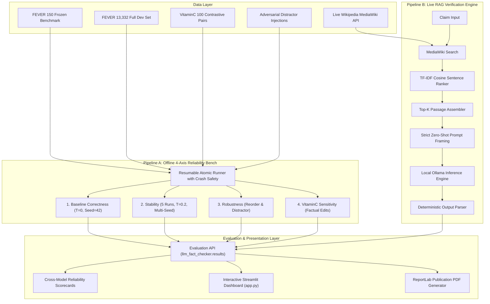

# Evidence-Grounded LLM Fact-Verification & Reliability Test Bench

[](https://www.python.org/)
[](tests/)
[](https://ollama.com/)
[](data/)
[](app.py)

**Author / Lead Contributor:** Aryan Goel  
**Focus:** Natural Language Processing, LLM Evaluation, RAG Fact-Verification & Reliable AI Systems  
**Publication Report:** [Fact_Checking_LLM_Benchmark_Report_Aryan_Goel.pdf](report/Fact_Checking_LLM_Benchmark_Report_Aryan_Goel.pdf)

---

## 🎯 Executive Summary & Real-World Motivation

Can small and mid-sized open-weights language models (1B–8B) be trusted as **evidence-grounded fact-checkers** in production systems? 

In high-stakes enterprise applications—such as legal compliance, medical question-answering, financial auditing, and Retrieval-Augmented Generation (RAG) guardrails—a fact-verifier cannot simply be measured by standard benchmark accuracy. Real-world deployment introduces noisy retrieved contexts, semantic distractors, multi-query non-determinism, and subtle factual edits.

This repository provides an **end-to-end reliability test bench and live RAG fact-verification framework**. It does not merely ask *"is this claim true?"*; it evaluates whether an LLM can strictly verify a natural language claim given supplied Wikipedia evidence across **four core dimensions of reliability**:

| Dimension | Critical Question | Evaluation Experiment | Dataset & Scale |
| :--- | :--- | :--- | :--- |
| **1. Correctness** | Does the model produce the verified verdict from evidence? | Zero-shot baseline ($T=0, \text{seed}=42$) | FEVER (150 frozen sample & 13,332 full dev set) |
| **2. Stability** | Does the model repeat the exact verdict under multi-query variance? | 5-run consistency ($T=0.2$, seeds 101–505) | 750 requests on same 150 claims |
| **3. Robustness** | Does irrelevant or reordered evidence degrade the verdict? | Evidence reversal & neutral distractor injection | 150 claims with audited Wikipedia distractors |
| **4. Sensitivity** | Can the model detect factual Wikipedia revision diffs? | Contrastive pair sensitivity ($\text{SUPP} \leftrightarrow \text{REF}$) | VitaminC (100 frozen pairs & 40,464 full set) |

In addition to offline reliability benchmarking, this system features a **production-ready live RAG pipeline** that pairs the MediaWiki Search API with a TF-IDF cosine similarity sentence ranker, an **interactive Streamlit Web Dashboard** (`app.py`), and a publication-quality **ReportLab PDF report generator**.

---

## 🏆 Cross-Model Reliability Scorecard

All models were evaluated under identical frozen prompts, deterministic parsers, and audited data splits. Every result is committed with cryptographic hash verification under [`results/`](results/).

| Model | Parameters | FEVER Acc | SUPP Acc | REF Acc | NEI Rate | 5/5 Consistency | Distractor Invariance | Post-Distractor Acc | VitaminC Sensitivity |
| :--- | :---: | :---: | :---: | :---: | :---: | :---: | :---: | :---: | :---: |
| **Llama 3.2** | 1B | 50.7% | 96.0% | 5.3% | 10.0% | 70.7% | 83.3% | 46.0% | 1.0% |
| **Llama 3.2** | 3B | 64.7% | 77.3% | 52.0% | 23.3% | 80.0% | 39.3% | 14.7% | 27.0% |
| **Phi-4 Mini** | 3.8B | 58.0% | 96.0% | 20.0% | 24.7% | 90.0% | 62.4% | 32.0% | 16.0% |
| **Qwen 2.5** ⭐ | 7B | **90.7%** | **88.0%** | **93.3%** | **0.7%** | **98.0%** | **95.2%** | **88.0%** | **72.0%** |

*Definitions: **SUPP Acc** = accuracy on supporting evidence; **REF Acc** = accuracy on refuting evidence; **NEI Rate** = rate of returning NOT ENOUGH INFORMATION; **Distractor Invariance** = fraction of verdicts unchanged after adding a neutral distractor; **VitaminC Sensitivity** = fraction of contrastive pairs where the model correctly predicts BOTH the supporting revision and the refuting revision.*

---

## 💡 Key Empirical Discoveries for Machine Learning Engineers

### 1. Severe Affirmative Confirmation Bias in Sub-4B Models
Small models exhibit strong sycophancy and prior bias:
- `llama3.2:1b` achieved 96.0% accuracy on supporting evidence but collapsed to **5.3%** on refuting evidence. It systematically agrees with claims regardless of contradictory evidence.
- `phi4-mini:3.8b` similarly biased heavily towards `SUPPORTED` (96.0% SUPP vs 20.0% REF).

### 2. Catastrophic Distractor Collapse in 3B Models
Adding just **one irrelevant neutral sentence** from the same Wikipedia article:
- Causes `llama3.2:3b` accuracy to crash from **64.7% down to 14.7%** (only 39.3% invariance).
- The model defensively retreats into `NOT ENOUGH INFORMATION` (NEI count jumped from 35 to 104).
- In production RAG systems, top-k retrieval often returns slightly off-topic sentences; a model that panics upon encountering neutral context is unusable without severe filtering.

### 3. The 7B Parameter Phase Transition
- `qwen2.5:7b` demonstrates high grounded intelligence: **90.7% accuracy**, balanced class precision (88.0% SUPP, 93.3% REF), **98.0% multi-seed stability**, and **95.2% distractor resistance**.
- Crucially, it achieves **72.0% contrastive sensitivity** on VitaminC, proving that it attends to minute token-level factual edits rather than relying purely on memorized training priors.

---

## 🏗️ System Architecture



---

## 🚀 Quickstart & Installation

### 1. Prerequisites
- macOS (Apple Silicon recommended) or Linux
- Python 3.10+
- [Ollama](https://ollama.com/) (for running local LLM inference)
- [uv](https://docs.astral.sh/uv/) (optional, but recommended for instant reproducible setup)

### 2. Clone and Install
```bash
git clone https://github.com/aryan-goel/fever-vitaminc-llm-benchmark.git
cd fever-vitaminc-llm-benchmark

# Option A: Fast setup using uv (recommended)
uv sync

# Option B: Standard pip setup
python3 -m venv .venv
source .venv/bin/activate
pip install -r requirements.txt
pip install -e .
```

### 3. Verify Offline Test Suite
The repository includes a comprehensive 162-test suite that verifies crash safety, metric exactness, data audits, and golden pilot metrics **100% offline without needing Ollama or GPU access**:
```bash
make test
# or: python3 -m unittest discover -s tests -v
# Output: Ran 162 tests in ~6.5s -> OK
```

---

## 💻 How to Run

### Option 1: Interactive Streamlit Web Dashboard
Launch the full interactive dashboard to explore radar charts, failure taxonomies, contrastive pair diffs, and the live RAG playground:
```bash
make demo
# or: streamlit run app.py
# or: python -m llm_fact_checker demo
```
Navigate to `http://localhost:8501` to view:
- **📊 Cross-Model Scorecard**: Interactive Plotly radar charts, distractor drop graphs, and class-balance bars.
- **🧪 Live RAG Fact-Checking**: Enter any natural language claim; fetches Wikipedia text in real-time, ranks sentences with TF-IDF, and runs local LLM verification.
- **🛡️ Distractor Stress-Test**: Inspect how irrelevant sentences trick models into over-cautious refusal.
- **🔄 VitaminC Sensitivity Explorer**: Visualize side-by-side Wikipedia revision diffs.
- **🔍 Error Taxonomy**: Filter by error types (`OVER_CAUTIOUS_NEI`, `HALLUCINATED_VERDICT`, `FALSE_REFUTATION`).
- **📄 Technical PDF Report**: Download or preview the 8-page compiled publication report.

---

### Option 2: Command-Line Interface (`factcheck`)

```bash
# Display the master Cross-Model Scorecard table
python -m llm_fact_checker scorecard

# Live RAG verification of any natural language claim
python -m llm_fact_checker rag --claim "The Roman Empire fell in 476 AD." --model qwen2.5:7b --top-k 3

# Run the FEVER baseline correctness experiment (150 claims)
python -m llm_fact_checker run --model qwen2.5:7b

# Run the 5-run stability experiment (750 requests, T=0.2)
python -m llm_fact_checker consistency --model qwen2.5:7b

# Run the evidence robustness experiment (reordering & distractor injection)
python -m llm_fact_checker robustness --model qwen2.5:7b

# Run the VitaminC sensitivity experiment (100 contrastive pairs)
python -m llm_fact_checker vitaminc-sensitivity --model qwen2.5:7b

# Compile the publication-quality technical PDF report
make report
# or: python -m llm_fact_checker report
```

---

## 🔬 Rigorous Engineering & MLOps Standards

This project follows enterprise-grade software and data engineering practices:

1. **Standard-Library Pure Core Pipeline**: The core experiment runner uses standard library `urllib` and `json` to guarantee zero dependency rot, high throughput, and reproducibility across operating systems.
2. **Resumable Inference & Atomic Disk Writes**: All predictions are written incrementally and atomically (`write_text_atomic`). If an experiment is interrupted or an LLM crashes after 5 hours, passing `--resume` picks up exactly where it left off without duplicate inference calls.
3. **Golden Regression Testing**: `tests/test_golden_results.py` pins published baseline metrics, prompt templates, and markdown reports. A refactor cannot silently modify numbers without failing CI.
4. **Clean Error Taxonomy**: Custom classification logic separates errors into `CORRECT`, `OVER_CAUTIOUS_NEI`, `HALLUCINATED_VERDICT`, `FALSE_REFUTATION`, and `FALSE_SUPPORT`.
5. **No Data Leakage**: Frozen sample hashes are tracked in `data/HASHES.txt` and verified programmatically before every benchmark run.

---

## 📁 Repository Directory Structure

```text
fever-vitaminc-llm-benchmark/
├── app.py                     # Interactive Streamlit Web Dashboard (Plotly + RAG)
├── config.json                # Central configuration (paths, models, hyperparameters)
├── Makefile                   # Clean development targets (test, lint, format, demo, report)
├── pyproject.toml             # Modern packaging & dependency specification
├── requirements.txt           # Locked environment dependencies
├── README.md                  # Comprehensive portfolio documentation
│
├── llm_fact_checker/          # Core reliability test bench package
│   ├── cli.py                 # Multi-command CLI (prepare, run, consistency, rag, demo)
│   ├── common.py              # Atomic I/O, hashing, and execution helpers
│   ├── evaluation.py          # Metric calculations (Precision, Recall, Macro-F1, Confusion Matrix)
│   ├── models.py              # Model tags, slugs, and supported architectures
│   ├── ollama.py              # Zero-dependency HTTP client with retry & timeout logic
│   ├── prompts.py             # FROZEN fact-checking prompt template & deterministic parser
│   ├── results.py             # Object-oriented read-only Results API for discovery & querying
│   ├── data_prep/             # FEVER & VitaminC data extraction and audit scripts
│   └── experiments/           # 4 reliability runners (baseline, consistency, robustness, sensitivity)
│
├── src/                       # RAG retrieval, error analysis & PDF reporting
│   ├── retrieve_evidence.py   # MediaWiki API search + TF-IDF sentence ranker with local caching
│   ├── inspect_data.py        # Dataset schema validation & label balance inspector
│   ├── analyse_errors.py      # Error taxonomy categorization & disagreement matrices
│   ├── evaluate_results.py    # Metric computation, confusion matrix heatmaps & bar plots
│   └── generate_pdf_report.py # ReportLab publication PDF compiler
│
├── data/                      # Frozen evaluation splits & audit manifests
│   ├── HASHES.txt             # Cryptographic SHA-256 hashes of frozen benchmarks
│   ├── sample_manifest.csv    # Balanced evaluation sample manifest
│   ├── wiki_cache.json        # Persistent local cache for Wikipedia extracts
│   ├── fever/
│   │   ├── processed/         # Frozen 150-claim FEVER baseline
│   │   ├── prepared/          # Audited distractor & reordered evidence inputs
│   │   └── full/              # Full 13,332 FEVER dev set with embedded evidence
│   └── vitaminc/
│       ├── processed/         # Frozen 100 contrastive VitaminC pairs
│       └── raw/vitaminc/      # Official VitaminC test split
│
├── results/                   # Committed benchmark runs across all 4 models
│   ├── CROSS_MODEL_SCORECARD.md
│   ├── fever/                 # Baseline, consistency, and robustness outputs
│   │   ├── llama3.2_1b/
│   │   ├── llama3.2_3b/
│   │   ├── phi4-mini_3.8b/
│   │   └── qwen2.5_7b/
│   └── vitaminc/              # Contrastive sensitivity outputs across all models
│
├── notebooks/                 # Exploratory data analysis & auditing
│   ├── 01_data_audit_fever.ipynb
│   ├── 01_data_audit_vitaminc.ipynb
│   └── 02_model_benchmark_comparison.ipynb
│
├── report/                    # Publication PDF report & markdown template
│   ├── Fact_Checking_LLM_Benchmark_Report_Aryan_Goel.pdf
│   └── benchmark_report.md
│
└── tests/                     # 162 unit & regression tests (100% passing offline)
    ├── test_baseline.py
    ├── test_consistency.py
    ├── test_robustness.py
    ├── test_golden_results.py
    └── fake_ollama.py
```

---

## 💼 Takeaways for Data Science & AI Hiring Teams

This project demonstrates core competencies sought in **Master's-level NLP / ML / Data Science candidates**:

1. **Applied NLP & RAG Architecture**: Understanding that high performance requires integrating dense or sparse retrieval (TF-IDF / BM25 / vector embeddings) with strict prompt framing and grounded constraints.
2. **Evaluation Rigor Beyond Naive Accuracy**: Moving beyond simple top-1 accuracy to design adversarial stress-tests (distractor invariance), stability testing (multi-seed stochastic drift), and sensitivity auditing (contrastive revisions).
3. **Robust Software Engineering**: Building production-quality, test-driven (`pytest`/`unittest`), resumable, and modular Python packages with strict type annotations and atomic disk operations.
4. **End-to-End Product Delivery**: Delivering not just code, but an interactive visualization dashboard, automated PDF technical reports, and clear executive scorecards.

---

## 📜 License & Citation

Developed for academic and professional portfolio demonstration by **Aryan Goel**.  
Built upon the FEVER (*Thorne et al., 2018*) and VitaminC (*Schuster et al., 2021*) benchmarks.
